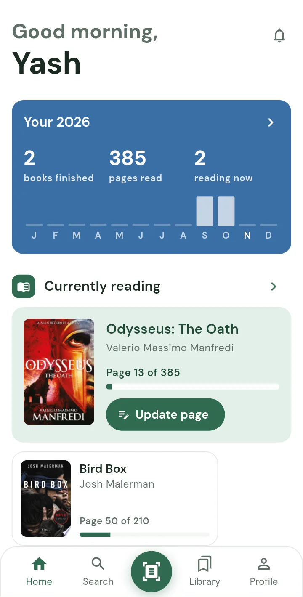
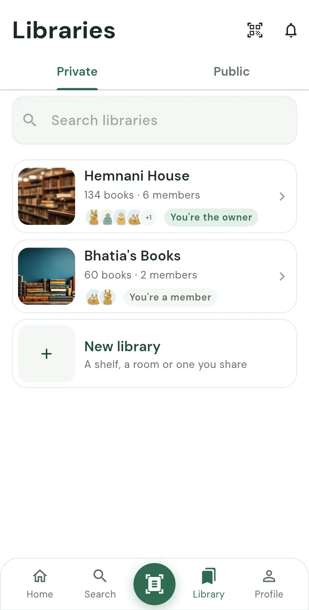
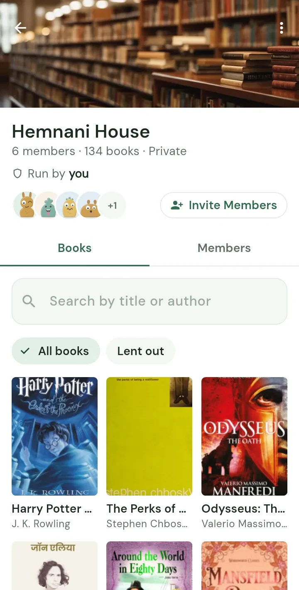
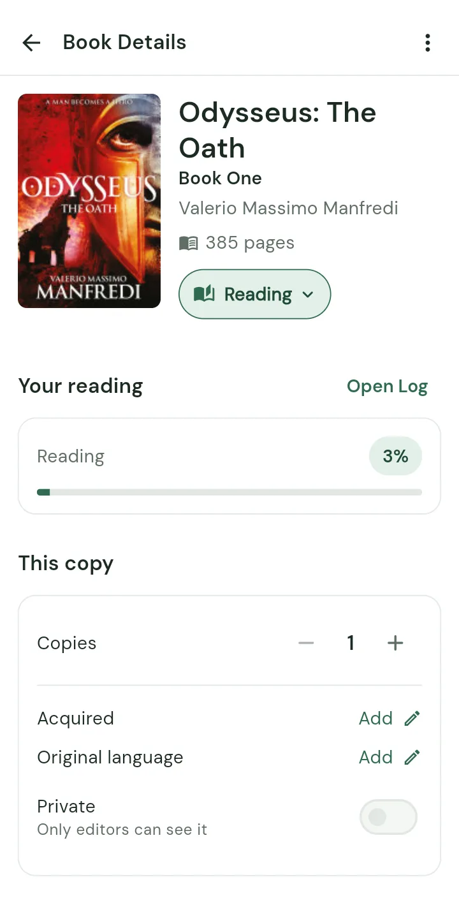
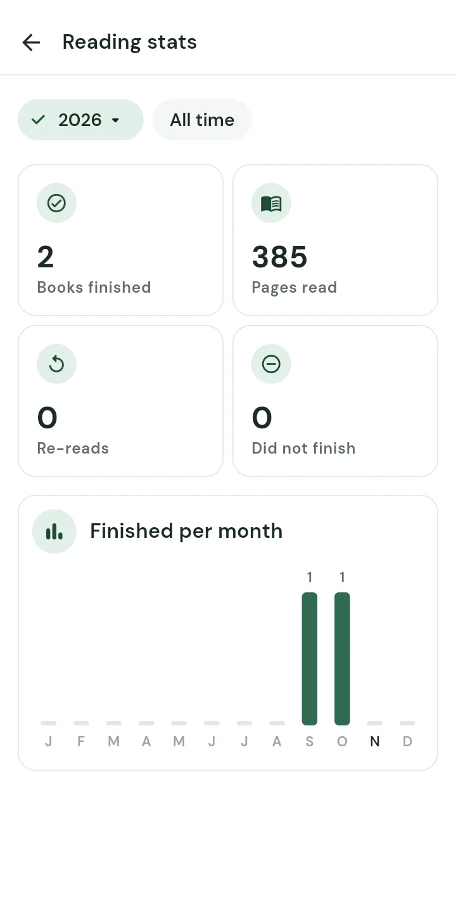
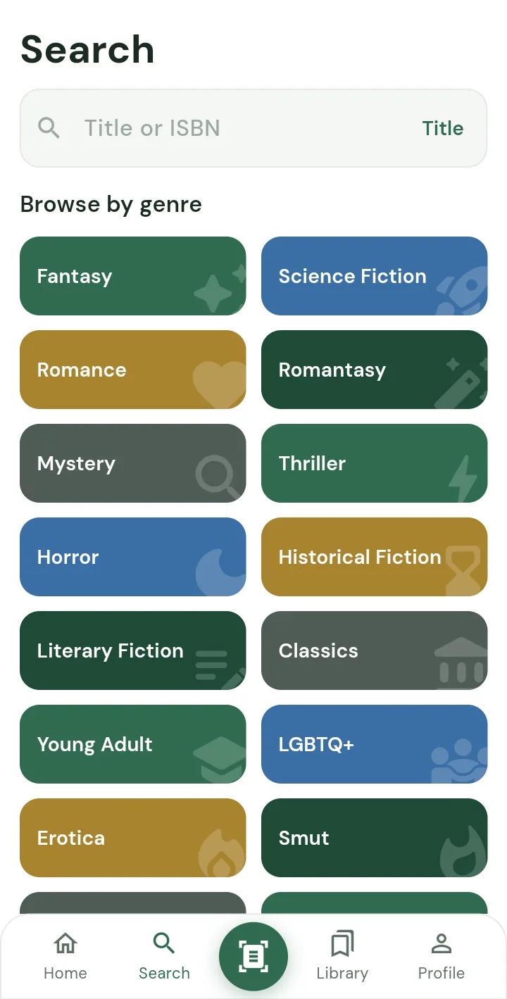
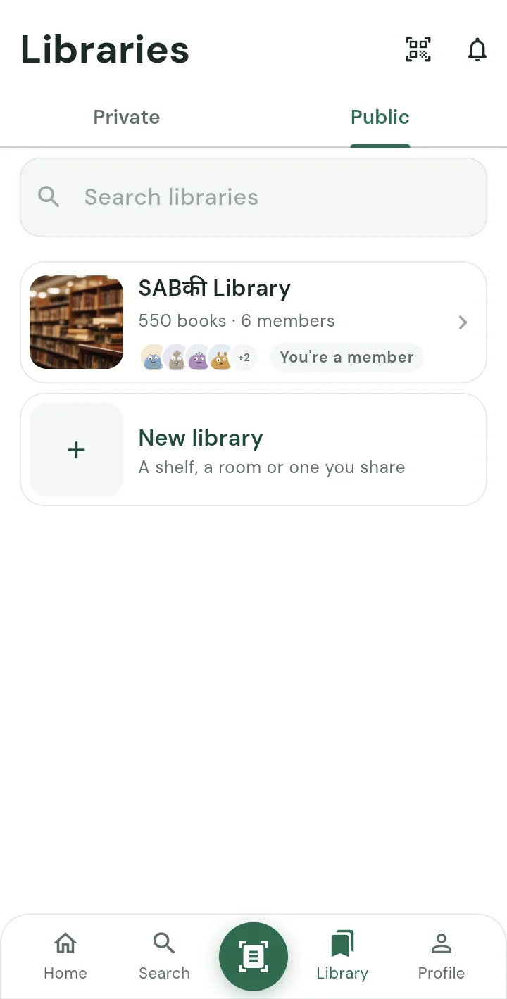

# ShelfSnap

ShelfSnap reads the spines in a photo of your bookshelf and builds a catalogue you can search, share with people and lend from. It works for one reader, a whole family, or the shelf in a café.

**[Download the latest APK (Android)](https://github.com/yash25hemnani/shelf-snap-app/releases/latest/download/app-arm64-v8a-release.apk)** · [All releases](https://github.com/yash25hemnani/shelf-snap-app/releases) · [Website](https://shelf-snap-wrapper.vercel.app)

<p>
  
  
  
  
</p>
<p>
  
  
  
</p>

## Install

ShelfSnap is sideloaded, not on the Play Store.

1. On your Android phone, download the APK from the link above. Most phones want `arm64-v8a`. Older 32-bit phones want `armeabi-v7a`, and emulators want `x86_64`.
2. Open the file and allow installs from your browser when Android asks.
3. Later versions show up as an update card on Home, which downloads and installs the new APK for you.

## Features

- **Scan a shelf.** Photograph a whole row of spines, or scan barcodes one at a time. ShelfSnap reads the text on the phone, works out which books are there and fills in the cover, author and page count.
- **Shared libraries.** Invite people with a link or a QR code. Owners and editors add books, and members browse.
- **Public libraries.** Make a library public and it gets its own web page that anyone can browse without the app. People can ask to join, and the owner can add an address or a Maps link.
- **Search.** Search every library you're in by title or author, or browse by genre.
- **Reading log.** Track the page you're on, start and finish dates, re-reads, a rating out of 10 and a review.
- **Reading stats.** Books finished, pages read and a chart of each month, for any year.
- **Lending.** Request a copy, agree on collect and return dates, and mark it handed over, returned or lost. You can also lend to someone who isn't on the app.
- **Friends.** Add friends by @username, see what they're reading and have finished, and follow their activity on Home.
- **Notifications.** Invites, join requests, friend requests and loan requests in one place.
- **In-app updates.** Home checks GitHub Releases and installs newer versions.

## Tech stack

- **Flutter** (Dart 3) with **Riverpod 2** for state
- **Firebase Auth** for sign-in and **Cloud Firestore** for data, with access controlled in [`firestore.rules`](firestore.rules)
- **Google ML Kit** text recognition for reading spines on the phone
- **mobile_scanner** for barcodes
- A small **Node.js API** (Express on Vercel) that groups spine text into books, looks up book details, and serves the public library web pages
- **DiceBear** Clay avatars, **qr_flutter** for library QR codes, **ota_update** for in-app updates

Code is organised by feature under `lib/features/` (auth, discover, friends, home, invites, lending, library, profile, reading, scanner, search, update). Each feature has its own models, providers, repositories, screens and widgets.

## Build from source

### Prerequisites

- [Flutter](https://docs.flutter.dev/get-started/install) 3.41 or later (Dart `^3.11.4`)
- Android SDK and a phone or emulator
- Your own Firebase project with Email/Password sign-in and Cloud Firestore turned on
- The [FlutterFire CLI](https://firebase.google.com/docs/flutter/setup) and the Firebase CLI

### Steps

1. Install packages:
   ```sh
   flutter pub get
   ```
2. Connect your Firebase project. This regenerates `lib/firebase_options.dart`:
   ```sh
   flutterfire configure
   ```
3. Deploy the security rules and indexes to your project:
   ```sh
   firebase deploy --only firestore
   ```
4. Create a `.env` file in the project root with the address of the book API:
   ```
   API_BASE_URL=https://your-api.example.com
   ```
5. Run the app:
   ```sh
   flutter run
   ```

### Release build

```sh
flutter build apk --release --split-per-abi
```

The APKs are written to `build/app/outputs/flutter-apk/`. To sign with your own key, create `android/key.properties` (it's ignored by git) with `storeFile`, `storePassword`, `keyAlias` and `keyPassword`. Without that file, release builds are signed with the debug key.

### Checks

```sh
flutter analyze
flutter test
```
